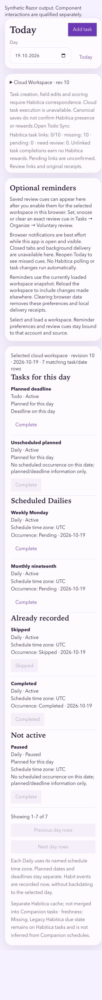
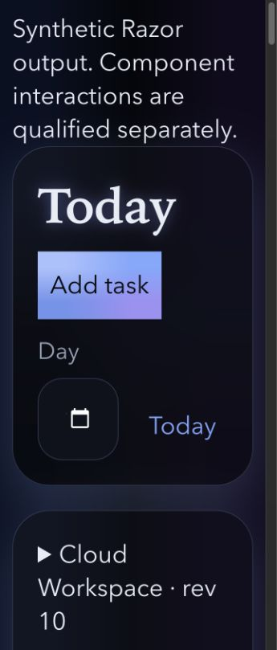
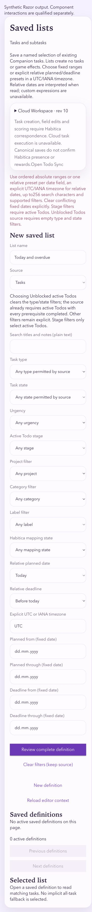
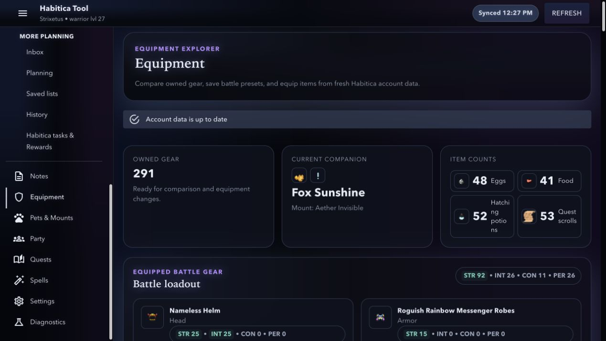

# Habitica Companion UX and UI review

Review date: 2026-11-03, Asia/Novosibirsk.

## Overall assessment

The application exposes substantial working functionality and careful mutation boundaries. The principal usability problems are reaching daily work, understanding the selected data source, locating existing records and completing forms without reading implementation-oriented instructions. The principal UI problems are navigation semantics, faint disabled controls, native date clipping at enlarged text and several inconsistent metadata presentations.

All 24 distinct new findings are captured as Pending through the installed Add Pending helper. No finding is promoted or implemented. Five overlapping backlog areas are referenced below without duplicate intake.

## Scope and evidence

- The deployed application was reviewed in the Codex in-app browser, including saved-data entry and the existing owner test account. Navigation, filters, local disclosures, theme changes and empty draft entry were used. No task scoring, equipment changes, spells, party mutations, deletion, new consent or publication was performed. Existing private sync performed normal background work; appearance changes are part of the reviewed UI.
- Current source was inspected alongside existing tests. The working tree already contained substantial product changes; the review adds planning and evidence files only. [Identity and source fingerprints](identity.json) separate the exact local checkout from fetched public deployed asset fingerprints. Public HTTP fingerprints do not establish the exact service-worker-controlled browser build.
- After explicit owner authorization, the current Blazor Release build was published to an isolated temporary directory. The web/component suite passed **1029 of 1029 tests, with zero failures and zero skips**, producing 379 fresh synthetic Razor states. [Test summary](test-summary.json), [TRX](web-component-tests.trx), [fixture provenance](coverage.json).
- A representative 62-state subset ran **1240 rendered cases**: 360/1280 CSS pixels, 100/200-percent root text and Gryphy Light, Gryphy Dark, Obsidian Glow, Toxic Swamp and Boss Battle. The matrix reported zero detected overflow, overlap, enabled-text contrast errors, harness errors or unsupported sampled paint. [Selection](matrix-selection.json), [measurements](matrix-results.json), [matrix configuration](audit-matrix.html).
- Two seeded cases detected page overflow, overlapping controls and deliberately unreadable contrast, confirming the relevant detector paths. [Canary measurements](matrix-canaries.json).
- Deployed normal-text screenshots include 390 by 844 and 1280 by 720 viewports, with Gryphy Light and Obsidian Glow across the game surfaces. Manual keyboard samples cover navigation, gear disclosure, spell target focus and New note heading focus. The local matrix supplies enlarged-text evidence for selected current-source states; the entire deployed application was not tested with actual browser zoom or operating-system text settings.
- Screenshots were saved and visually inspected in the current run. Loading and partially animated captures were rejected. [Accepted screenshot index](screenshots.md), [deployed geometry and control inventory](captures.json), [rejected capture reasons](rejected-captures.json).

## Numbered journey review

### 1. Entry and privacy

Routes: `/sign-in, /, /signin, /privacy`.

Usable with lengthy explanatory copy. Sign-in, saved-data entry, mobile jump link and separate consent disclosures remain clear. No new authentication defect established.

Evidence: [70-sign-in-phone-light](screenshots/70-sign-in-phone-light.png), [71-sign-in-phone-obsidian](screenshots/71-sign-in-phone-obsidian.png), [72-privacy-phone-obsidian](screenshots/72-privacy-phone-obsidian.png).

### 2. Planning and task lifecycle

Routes: `/todo/today, /todo/habits, /todo/dailies, /todo/tasks, /todo/inbox, /todo/plan, /todo/lists, /todo/history, /todo/statistics, /tasks`.

Needs improvement. Inconsistent capture destinations, headings, task-first hierarchy, authoring complexity and enlarged date presentation. Populated, review, unavailable and unknown-command states are represented locally.

Evidence: [45-local-today-phone-light-100](screenshots/45-local-today-phone-light-100.png), [44-local-today-phone-obsidian-200](screenshots/44-local-today-phone-obsidian-200.png), [46-local-lists-phone-light-100](screenshots/46-local-lists-phone-light-100.png).

### 3. Projects and Notes

Routes: `/todo/projects, /notes, /todo/convert, /todo/convert/{SourceTaskId:guid}, /todo/retire/{ConversionId:guid}`.

Needs improvement. Creation and management precede browsing; phone editing and copy-review readability need work. Exact identity, drafts and original-receipt boundaries remain represented.

Evidence: [50-local-projects-phone-light-100](screenshots/50-local-projects-phone-light-100.png), [47-local-notes-phone-obsidian-200](screenshots/47-local-notes-phone-obsidian-200.png), [49-local-type-copy-phone-obsidian-100](screenshots/49-local-type-copy-phone-obsidian-100.png).

### 4. Workspace, sync and reminders

Routes: `/todo/sync, /todo/reminders, /todo/reminders/open`.

Needs improvement. Readiness and disabled reasons are unclear; unchecked push state and raw weekday inputs need correction. Existing live cloud access was not restored; local synthetic reviews cover the otherwise blocked screens.

Evidence: [30-sync-desktop-light](screenshots/30-sync-desktop-light.png), [31-reminders-desktop-light](screenshots/31-reminders-desktop-light.png), [51-local-reminders-phone-obsidian-100](screenshots/51-local-reminders-phone-obsidian-100.png).

### 5. Equipment and companion collection

Routes: `/inventory, /pets-mounts`.

Needs improvement. Item discovery, very large expanded collections and count-label wrapping impede scanning. Explicit mutation controls and inventory context remain present.

Evidence: [58-equipment-desktop-obsidian](screenshots/58-equipment-desktop-obsidian.png), [65-equipment-phone-light](screenshots/65-equipment-phone-light.png), [66-pets-phone-light](screenshots/66-pets-phone-light.png).

### 6. Party, quests and spells

Routes: `/party, /quests, /spells`.

Readable operational content with substantial density. Member details and spell focus were inspected without mutations. Existing quest-mode, table-context and spell-density backlog covers much of the structural work; repeated accessible names remain a new finding.

Evidence: [13-party-details-desktop-light](screenshots/13-party-details-desktop-light.png), [67-party-phone-light](screenshots/67-party-phone-light.png), [68-quests-phone-light](screenshots/68-quests-phone-light.png), [17-spells-phone-focus-light](screenshots/17-spells-phone-focus-light.png).

### 7. Dashboard, Settings and diagnostics

Routes: `/dashboard, /settings, /diagnostics, /live-tests`.

Needs improvement. Conflicting freshness labels, Settings hierarchy, timestamp formatting and contextual control names need work. Diagnostic filters and separate upload consent remain explicit.

Evidence: [64-dashboard-phone-light](screenshots/64-dashboard-phone-light.png), [69-settings-phone-light-stable](screenshots/69-settings-phone-light-stable.png), [20-diagnostics-phone-light-drawer](screenshots/20-diagnostics-phone-light-drawer.png).

## UX findings

Task ordering, navigation, form design and status comprehension account for F03–F17. The strongest recurring pattern is management or explanatory content preceding the work being requested. The Today, saved-list, Projects and Notes captures demonstrate the issue with current rendered content rather than inferred style preferences.

## UI and accessibility findings

F01–F02 and F18–F24 address semantics, focus targets, readable states, native control content and metadata presentation. The passing matrix measures outer geometry and enabled text nodes. It intentionally skips disabled text and cannot inspect native date shadow content; F19 and F20 therefore remain valid manual findings. No complete WCAG conformance claim follows from the automated results.

## Pending task index

| Finding | Priority | Pending ID | Title |
| --- | ---: | --- | --- |
| [F01](#f01) | 105 | `P-8e0bae93-5539-40e5-b2b7-8b52fd5fbcea` | Make global navigation identifiable and keyboard accessible |
| [F04](#f04) | 105 | `P-10dedd84-9a90-447e-bf89-c3dcb81affc7` | Explain workspace readiness and disabled editor recovery |
| [F02](#f02) | 104 | `P-bf4b432a-db9b-4315-acd0-7edfb6618aa6` | Provide page headings and route focus for Habits and Dailies |
| [F20](#f20) | 104 | `P-b302aa68-7d63-4f74-9aa7-338c56700923` | Keep selected native dates readable with enlarged text |
| [F03](#f03) | 103 | `P-4870adee-f7e9-4dd3-b4c1-71b2b6b33635` | Use consistent canonical task destinations from planning views |
| [F05](#f05) | 103 | `P-1e35a85f-82f8-48cd-93a5-001c8fd6f539` | Put daily work before optional reminder setup on Today |
| [F07](#f07) | 103 | `P-2897d6c0-a804-41fe-9d92-091049683fa3` | Bound companion collection rendering and clarify search results |
| [F24](#f24) | 103 | `P-d3dd549c-426f-4e67-9061-df88247cba31` | Reconcile dashboard account freshness and refresh-history labels |
| [F09](#f09) | 102 | `P-d3155b74-ab23-4ed6-8073-e794af664988` | Place required Daily schedule fields before the add action |
| [F12](#f12) | 102 | `P-4cc94496-9709-4454-9fd6-ae1f0227a1b7` | Identify the exact invalid saved-list fields and preserve focus |
| [F18](#f18) | 102 | `P-fa41f9c2-ce38-45c2-a42f-f3831eb48a45` | Give repeated record controls contextual names and disclosure state |
| [F19](#f19) | 102 | `P-b7836285-3b2f-434b-8716-cd3e78482dda` | Keep disabled control text readable in built-in themes |
| [F16](#f16) | 101 | `P-1ffff778-5db1-447c-95f7-fde01d72e70c` | Distinguish unchecked push capability from unsupported browsers |
| [F06](#f06) | 100 | `P-49528543-08db-4727-a2ca-bf390aa3b7d5` | Make primary planning navigation reachable without a long drawer scan |
| [F08](#f08) | 100 | `P-0e537656-6bec-434b-8f6f-6f8a6fd73ff2` | Add direct discovery for equipment slots and owned items |
| [F10](#f10) | 100 | `P-d5ab0ee8-193d-4bc0-81e6-e0daf24ac330` | Offer understandable supported timezone choices for linked Dailies |
| [F11](#f11) | 100 | `P-980fdd4a-8af6-47cb-a2ab-0cca80f54139` | Shorten saved-list authoring and prioritize existing lists |
| [F13](#f13) | 100 | `P-ec998b4e-f73d-47cc-a884-06b5619f717c` | Make phone note capture reach the editor directly |
| [F14](#f14) | 100 | `P-356b4e1b-8559-4922-9ec8-fbf713f5eedb` | Open Projects on existing work and reveal management on demand |
| [F15](#f15) | 100 | `P-497c699c-dd18-4f62-a9ba-d3bccfc2cda0` | Organize Settings around clear account and data-management sections |
| [F17](#f17) | 100 | `P-a8c875ae-145d-4273-9d4b-fbf76d22e7f8` | Use named day controls for repeating push reminders |
| [F21](#f21) | 100 | `P-ae822766-780c-4584-a33f-d8978ee060c0` | Prevent mid-word wrapping in equipment count summaries |
| [F22](#f22) | 100 | `P-23e38a95-a8c7-4748-b8bf-6f1bcfcda84b` | Format private-sync timestamps without literal format suffixes |
| [F23](#f23) | 100 | `P-16d346af-15c0-4b5f-9d5a-b80d50d2259f` | Show explicit unset values in task-copy reviews |

## Finding details

### F01. Make global navigation identifiable and keyboard accessible

Category: Accessibility. Priority: 105. Pending: `P-8e0bae93-5539-40e5-b2b7-8b52fd5fbcea`.

The authenticated shell menu button has no accessible name or expanded-state association. The navigation precedes more than twenty destinations without a skip-to-content link.

Expected outcome: Expose a meaningful menu name and current expansion state, provide a keyboard shortcut through a visible-on-focus skip link, and verify phone drawer dismissal and focus return without changing account permissions.

MainLayout.razor renders MudIconButton without Label, aria-label or aria-expanded. The deployed accessibility tree exposes an unnamed button; no focus-trap failure is claimed.

Current source/test ownership: `src/Habitica.WebApp/Layout/MainLayout.razor:13`, `tests/Habitica.WebApp.Tests/Qualification/SharedLayoutEvidenceTests.cs`.

Screenshot evidence: [02-dashboard-desktop-light](screenshots/02-dashboard-desktop-light.png), [18-navigation-phone-light](screenshots/18-navigation-phone-light.png).

### F02. Provide page headings and route focus for Habits and Dailies

Category: Accessibility. Priority: 104. Pending: `P-bf4b432a-db9b-4315-acd0-7edfb6618aa6`.

The Habits and Dailies routes render the page titles as level-two headings and contain no level-one page heading. The shared shell heading precedes the content in the heading outline.

Expected outcome: Each route exposes one descriptive page-level heading and receives useful focus after navigation. Category tabs and immediate capture remain available.

TodoHabitsPage.razor and TodoDailiesPage.razor delegate the visible title to TodoTaskPanel. TodoCategoryPageTests cover the route and actions without asserting the page-level heading.

Current source/test ownership: `src/Habitica.WebApp/Pages/TodoHabitsPage.razor`, `src/Habitica.WebApp/Pages/TodoDailiesPage.razor`, `tests/Habitica.WebApp.Tests/Workspace/TodoCategoryPageTests.cs`.

Screenshot evidence: [22-habits-desktop-light](screenshots/22-habits-desktop-light.png), [23-dailies-desktop-light](screenshots/23-dailies-desktop-light.png), [48-local-daily-phone-light-100](screenshots/48-local-daily-phone-light-100.png).

### F03. Use consistent canonical task destinations from planning views

Category: UX. Priority: 103. Pending: `P-4870adee-f7e9-4dd3-b4c1-71b2b6b33635`.

Inbox and Planning Add task links lead to /tasks, while Today Add task leads to /todo/tasks. History and Statistics also return to the mixed legacy /tasks surface, which shows both Companion capture and separate Habitica records.

Expected outcome: Ordinary Companion capture and return links use the canonical task surface consistently. Intentional links to the separate Habitica cache remain explicitly named and retain separate identity and reward semantics.

TodoPlanningPanel.razor, TodoHistoryPanel.razor and TodoStatisticsPanel.razor hardcode /tasks. The /tasks route still contains a Companion editor, so the issue is context and navigation consistency rather than missing capture functionality.

Current source/test ownership: `src/Habitica.WebApp/Components/TodoPlanningPanel.razor:10`, `src/Habitica.WebApp/Components/TodoHistoryPanel.razor:9`, `src/Habitica.WebApp/Components/TodoStatisticsPanel.razor:10`.

Screenshot evidence: [26-inbox-desktop-light](screenshots/26-inbox-desktop-light.png), [27-planning-desktop-light](screenshots/27-planning-desktop-light.png), [33-habitica-tasks-desktop-light](screenshots/33-habitica-tasks-desktop-light.png).

### F04. Explain workspace readiness and disabled editor recovery

Category: UX. Priority: 105. Pending: `P-10dedd84-9a90-447e-bf89-c3dcb81affc7`.

The reviewed session initially shows Restoring Workspace, then Browser Workspace revision 1 with disabled task, project, saved-list and refresh controls. Generic correspondence text does not identify the actual condition preventing editing. Settings separately reports unverified existing server access.

Expected outcome: Show the observed source, loading or terminal unavailable state and precise read-only reason together with one relevant recovery action. Preserve browser recovery copies, original pending commands and independent consent; never silently select a different cloud source or enable execution.

TodoWorkspacePresentation combines coordinator availability, command read-only state and organization fences. Process Pending must establish the exact cause of the observed disabled state before selecting a behavioral fix; no data loss or automatic fallback is established.

Current source/test ownership: `src/Habitica.WebApp/State/TodoWorkspacePresentation.cs:85`, `src/Habitica.WebApp/State/CompanionConnectionCoordinator.cs`, `tests/Habitica.WebApp.Tests/Workspace/TodoWorkspacePresentationTests.cs`.

Screenshot evidence: [04-today-auth-desktop-light](screenshots/04-today-auth-desktop-light.png), [23-dailies-desktop-light](screenshots/23-dailies-desktop-light.png), [30-sync-desktop-light](screenshots/30-sync-desktop-light.png), [06-settings-desktop-light](screenshots/06-settings-desktop-light.png).

### F05. Put daily work before optional reminder setup on Today

Category: UX. Priority: 103. Pending: `P-1e35a85f-82f8-48cd-93a5-001c8fd6f539`.

Today places a full reminder explanation and repeated workspace correspondence text before the task groups. In the populated synthetic phone state, the first task starts several screens below the date controls; enlarged text increases the distance substantially.

Expected outcome: Keep the selected day and daily task groups easy to reach. Present optional reminder setup and detailed source explanations through concise summaries or disclosures, while retaining urgent readiness, pending-command and unknown-outcome notices.

TodoTodayPanel renders TodoReminderPanel before todo-today-groups. The current 360-pixel synthetic capture places the first task near document y=1300 at normal text and y=5442 at 200-percent text, including the synthetic evidence notice.

Current source/test ownership: `src/Habitica.WebApp/Components/TodoTodayPanel.razor:17`, `src/Habitica.WebApp/Components/TodoReminderPanel.razor`.

Screenshot evidence: [45-local-today-phone-light-100](screenshots/45-local-today-phone-light-100.png), [44-local-today-phone-obsidian-200](screenshots/44-local-today-phone-obsidian-200.png).

### F06. Make primary planning navigation reachable without a long drawer scan

Category: UX. Priority: 100. Pending: `P-49528543-08db-4727-a2ca-bf390aa3b7d5`.

The drawer starts with a large explanatory hero and presents more than twenty destinations. At 1280 by 720 pixels, primary planning destinations and account tools require independent drawer scrolling. Naming mixes Todo, Tasks and Habitica tasks and Rewards.

Expected outcome: Expose a clear compact hierarchy for frequent planning and game destinations, make the active section apparent, and keep common capture and account navigation easy to find. Retain direct routes and a clearly separate Habitica cache entry.

The scope is shell navigation and naming. Existing Returning User Copy Compression explicitly excludes navigation redesign and remains a separate backlog item.

Current source/test ownership: `src/Habitica.WebApp/Layout/MainLayout.razor:53`, `src/Habitica.WebApp/Components/Navigation/AppNavMenu.razor`.

Screenshot evidence: [02-dashboard-desktop-light](screenshots/02-dashboard-desktop-light.png), [18-navigation-phone-light](screenshots/18-navigation-phone-light.png), [57-dashboard-desktop-obsidian](screenshots/57-dashboard-desktop-obsidian.png).

### F07. Bound companion collection rendering and clarify search results

Category: UX. Priority: 103. Pending: `P-2897d6c0-a804-41fe-9d92-091049683fa3`.

The reviewed expanded Pets and Mounts state produces about 231507 pixels of desktop content and 490536 pixels on a phone. Search reduces the catalog but offers no aggregate result count or single empty-result recovery; separate group notices and unfiltered surplus inventory remain lengthy.

Expected outcome: Keep large expanded collections bounded and navigable, provide clear aggregate search feedback and a simple reset, and distinguish collection results from separate inventory-sale planning. Preserve explicit hatch, feed and sale previews.

PetsMountsPage renders matching pets and mounts inside each group and persists folds. The observed starting state includes saved expansion choices; no claim about a fresh profile default is made. Individual empty-group messages already exist.

Current source/test ownership: `src/Habitica.WebApp/Pages/PetsMountsPage.razor:348`, `src/Habitica.WebApp/Pages/PetsMountsPage.razor:655`, `tests/Habitica.WebApp.Tests/Pages/PetsMountsPageTests.cs`.

Screenshot evidence: [10-pets-desktop-light](screenshots/10-pets-desktop-light.png), [11-pets-no-results-desktop-light](screenshots/11-pets-no-results-desktop-light.png), [53-pets-phone-obsidian](screenshots/53-pets-phone-obsidian.png), [66-pets-phone-light](screenshots/66-pets-phone-light.png).

### F08. Add direct discovery for equipment slots and owned items

Category: UX. Priority: 100. Pending: `P-0e537656-6bec-434b-8f6f-6f8a6fd73ff2`.

Equipment shows loadout, optimizer, presets and repeated category grids before many owned items. The reviewed account has 291 items and an approximately 7526-pixel desktop page, with no item search or compact slot navigation.

Expected outcome: Provide a direct way to find an owned item or reach a slot without scanning the full page. Keep equipped identity, comparisons, optimizer choices and explicit equipment actions intact.

InventoryPage uses category expansion and best-in-category summaries, which should remain useful after discovery improves. No optimizer or Habitica equipment mutation change is requested.

Current source/test ownership: `src/Habitica.WebApp/Pages/InventoryPage.razor`, `tests/Habitica.WebApp.Tests/Pages/InventoryPageTests.cs`.

Screenshot evidence: [08-equipment-desktop-light](screenshots/08-equipment-desktop-light.png), [09-equipment-expanded-desktop-light](screenshots/09-equipment-expanded-desktop-light.png), [65-equipment-phone-light](screenshots/65-equipment-phone-light.png).

### F09. Place required Daily schedule fields before the add action

Category: UX. Priority: 102. Pending: `P-d3155b74-ab23-4ed6-8073-e794af664988`.

Daily capture places Add Daily immediately after the title and before required repeat, interval, start-date and timezone fields. On phones the primary action appears before the information needed to submit a valid Daily.

Expected outcome: Present Daily capture as one ordered form with required schedule inputs preceding the primary review or add action. Preserve title-first Todo and Habit capture, explicit schedule semantics and required Habitica correspondence.

The current linked-daily-editor capture shows the same action ordering as the deployed /todo/dailies route. No schedule backfill, Cron or provider penalty change is authorized.

Current source/test ownership: `src/Habitica.WebApp/Components/TodoTaskPanel.razor`, `tests/Habitica.WebApp.Tests/Workspace/TodoTaskPanelTests.cs`.

Screenshot evidence: [23-dailies-desktop-light](screenshots/23-dailies-desktop-light.png), [48-local-daily-phone-light-100](screenshots/48-local-daily-phone-light-100.png).

### F10. Offer understandable supported timezone choices for linked Dailies

Category: UX. Priority: 100. Pending: `P-d5ab0ee8-193d-4bc0-81e6-e0daf24ac330`.

Linked Daily creation asks for raw UTC or Etc/GMT identifiers with reversed offset signs. The recurring editor suggests Europe/Paris even when the selected linked schedule only accepts a supported fixed zone.

Expected outcome: Show understandable supported offset choices and context-specific labels, retaining exact normalized timezone identity in reviews. Unsupported DST and nonmidnight day-start behavior remains explicitly unavailable rather than silently converted.

TodoTaskPanel and TodoRecurringEditor have different supported linked and unlinked schedule constraints. Process Pending must preserve the linked-daily-schedules contract and fixed-offset sign semantics.

Current source/test ownership: `src/Habitica.WebApp/Components/TodoTaskPanel.razor`, `src/Habitica.WebApp/Components/TodoRecurringEditor.razor:24`, `.skill-tree/documents/linked-daily-schedules.md`.

Screenshot evidence: [48-local-daily-phone-light-100](screenshots/48-local-daily-phone-light-100.png).

### F11. Shorten saved-list authoring and prioritize existing lists

Category: UX. Priority: 100. Pending: `P-980fdd4a-8af6-47cb-a2ab-0cca80f54139`.

Saved lists opens a complete filter editor before saved definitions and results. The current phone example is about 3387 pixels tall and exposes source, type, state, urgency, organization, mapping and fixed and relative date controls together.

Expected outcome: Make existing definitions and matching results easy to reach, with a compact common creation path and additional filters on demand. Preserve complete reviewed definitions, explicit date conflicts and unavailable-result safeguards.

TodoSavedListPanel already collapses exact saved filters in results; the authoring form remains fully expanded. Relative-date support is implemented locally and must be included in the design research.

Current source/test ownership: `src/Habitica.WebApp/Components/TodoSavedListPanel.razor:30`, `tests/Habitica.WebApp.Tests/Workspace/TodoSavedListPanelTests.cs`.

Screenshot evidence: [28-lists-desktop-light](screenshots/28-lists-desktop-light.png), [46-local-lists-phone-light-100](screenshots/46-local-lists-phone-light-100.png).

### F12. Identify the exact invalid saved-list fields and preserve focus

Category: UX and accessibility. Priority: 102. Pending: `P-4cc94496-9709-4454-9fd6-ae1f0227a1b7`.

Saved-list validation can return one broad paragraph listing date ordering, relative presets, timezone, search length, stage and source constraints. The paragraph does not identify the specific invalid field or associate the error with the affected control.

Expected outcome: Name the actual invalid constraint beside the affected field, expose the association to assistive technology, preserve entered values and move or link focus usefully. Retain rejection of conflicting dates and unsupported definitions.

TodoSavedListDraft.Build throws a generic aggregate instruction when query validity fails. TodoSavedListPanel renders the message as a top-level alert without field-level invalid state.

Current source/test ownership: `src/Habitica.WebApp/State/TodoSavedListDraft.cs:45`, `src/Habitica.WebApp/Components/TodoSavedListPanel.razor:12`.

Screenshot evidence: [46-local-lists-phone-light-100](screenshots/46-local-lists-phone-light-100.png).

### F13. Make phone note capture reach the editor directly

Category: UX. Priority: 100. Pending: `P-ec998b4e-f73d-47cc-a884-06b5619f717c`.

The phone Notes view stacks source guidance, project and folder filters, library results and pagination before the editor. New note focuses the editor heading but leaves substantial preceding library and association controls on screen before the title and body.

Expected outcome: Provide a clear phone transition between finding notes and editing a note, with the title and writing area promptly reachable after New note. Preserve unsaved drafts, project and folder context, original receipt recovery and keyboard return paths.

The deployed New note interaction correctly moves focus to the editor heading; focus is not absent. Current local folder support adds further controls to the same stacked layout.

Current source/test ownership: `src/Habitica.WebApp/Components/NotesPanel.razor`, `tests/Habitica.WebApp.Tests/Notes/NotesPanelTests.cs`, `tests/Habitica.WebApp.Tests/Notes/NotesFolderPanelTests.cs`.

Screenshot evidence: [36-notes-phone-light](screenshots/36-notes-phone-light.png), [37-notes-new-phone-light](screenshots/37-notes-new-phone-light.png), [47-local-notes-phone-obsidian-200](screenshots/47-local-notes-phone-obsidian-200.png).

### F14. Open Projects on existing work and reveal management on demand

Category: UX. Priority: 100. Pending: `P-356b4e1b-8559-4922-9ec8-fbf713f5eedb`.

Projects places category selection, a new-project form and alias guidance before existing project records, the project task selector and linked Notes. The normal phone state spans roughly 3006 pixels before the page ends.

Expected outcome: Make existing projects and associated tasks and Notes the direct browsing path. Keep creation, optional organization and record management available through clear deliberate actions with the same reviews and retained identity rules.

TodoProjectsPage composes TodoOrganizationPanel before project task navigation. The request concerns entry hierarchy rather than changes to optional organization or project membership semantics.

Current source/test ownership: `src/Habitica.WebApp/Pages/TodoProjectsPage.razor`, `src/Habitica.WebApp/Components/TodoOrganizationPanel.razor`.

Screenshot evidence: [24-projects-desktop-light](screenshots/24-projects-desktop-light.png), [50-local-projects-phone-light-100](screenshots/50-local-projects-phone-light-100.png).

### F15. Organize Settings around clear account and data-management sections

Category: UX. Priority: 100. Pending: `P-497c699c-dd18-4f62-a9ba-d3bccfc2cda0`.

Settings begins with iPhone installation guidance before the page-level account heading and stacks session, appearance, integration, shared planning, three backup systems and destructive local clearing in one long page. The reviewed phone state is about 6467 pixels tall.

Expected outcome: Provide scannable section navigation and plain distinctions between browser data, private device sync and readable cloud Workspace data. Keep current connection state and likely next actions visible while preserving independent consent and destructive confirmation boundaries.

Existing Settings Danger Zone Confirmation covers destructive confirmation, not Settings information architecture. Returning User Copy Compression remains separate from account and data-management grouping.

Current source/test ownership: `src/Habitica.WebApp/Pages/SettingsPage.razor`, `tests/Habitica.WebApp.Tests/Pages/SettingsPageTests.cs`.

Screenshot evidence: [06-settings-desktop-light](screenshots/06-settings-desktop-light.png), [63-settings-desktop-obsidian](screenshots/63-settings-desktop-obsidian.png), [69-settings-phone-light-stable](screenshots/69-settings-phone-light-stable.png).

### F16. Distinguish unchecked push capability from unsupported browsers

Category: UX. Priority: 101. Pending: `P-1ffff778-5db1-447c-95f7-fde01d72e70c`.

Before Check push setup runs, the push panel displays Browser capability unprepared and Permission unsupported together. No browser capability observation has established unsupported permission at that point.

Expected outcome: Use an explicit not-checked state until capability is observed, then distinguish available, installation-required, denied and unsupported outcomes. Permission prompts remain restricted to the explicit device action.

PushDeviceController initializes BrowserPushCapability with unprepared and unsupported. The issue is status presentation, not evidence of failed notification delivery.

Current source/test ownership: `src/Habitica.WebApp/State/PushDeviceController.cs:18`, `src/Habitica.WebApp/Components/PushDevicePanel.razor:11`.

Screenshot evidence: [31-reminders-desktop-light](screenshots/31-reminders-desktop-light.png).

### F17. Use named day controls for repeating push reminders

Category: UX. Priority: 100. Pending: `P-a8c875ae-145d-4273-9d4b-fbf76d22e7f8`.

Weekly reminder setup asks for comma-separated weekday numbers from zero through six. Monthly setup similarly relies on a raw comma-separated list. Ordinary schedule selection requires knowledge of transport-oriented encodings.

Expected outcome: Offer named weekday choices and clear month-day selection with specific validation and a readable review. Preserve exact recurrence, timezone, DST, end-date, device consent and original-command behavior.

TaskPushReminderEditor uses text inputs for schedule-days and schedule-month-days. TodoRecurringEditor already provides named weekday checkboxes as a nearby interaction pattern.

Current source/test ownership: `src/Habitica.WebApp/Components/TaskPushReminderEditor.razor:28`, `src/Habitica.WebApp/Components/TodoRecurringEditor.razor:27`.

Screenshot evidence: [51-local-reminders-phone-obsidian-100](screenshots/51-local-reminders-phone-obsidian-100.png).

### F18. Give repeated record controls contextual names and disclosure state

Category: Accessibility. Priority: 102. Pending: `P-fa41f9c2-ce38-45c2-a42f-f3831eb48a45`.

Task Complete and Details, gear Equip item, member Details and Settings Exclude controls repeat without record-specific accessible names. Member detail toggles also omit expanded-state and controlled-region associations; preset-name fields rely on placeholders.

Expected outcome: Keep short visible labels while exposing the affected record or sync section in accessible names, persistent input labels and disclosure state. Verify keyboard and screen-reader-oriented navigation without changing action authorization.

The current accessibility snapshots and Razor source expose repeated generic controls. Duplicate button text alone is treated as a navigation risk rather than a blanket compliance failure; the unnamed global menu remains a separate finding.

Current source/test ownership: `src/Habitica.WebApp/Pages/PartyPage.razor:795`, `src/Habitica.WebApp/Pages/InventoryPage.razor:237`, `src/Habitica.WebApp/Pages/SettingsPage.razor:270`.

Screenshot evidence: [09-equipment-expanded-desktop-light](screenshots/09-equipment-expanded-desktop-light.png), [13-party-details-desktop-light](screenshots/13-party-details-desktop-light.png), [33-habitica-tasks-desktop-light](screenshots/33-habitica-tasks-desktop-light.png), [06-settings-desktop-light](screenshots/06-settings-desktop-light.png).

### F19. Keep disabled control text readable in built-in themes

Category: UI. Priority: 102. Pending: `P-b7836285-3b2f-434b-8716-cd3e78482dda`.

Disabled buttons become very faint in Gryphy Light and remain dim in Obsidian Glow. Normal-looking disabled Daily schedule inputs and low-visibility action labels make editor readiness harder to understand.

Expected outcome: Use readable disabled foreground, border and surface tokens with a clear noninteractive appearance and relevant disabled reasons. Verify actual disabled controls in light and dark themes at normal and enlarged text.

app.css uses disabled tokens, including translucent foregrounds, and applies additional opacity to Notes buttons. The rendered matrix intentionally skips disabled text contrast, so the passing matrix does not qualify disabled readability. No WCAG text-contrast violation is asserted for inactive controls.

Current source/test ownership: `src/Habitica.WebApp/wwwroot/css/app.css:3751`, `src/Habitica.WebApp/wwwroot/css/app.css:4749`, `tests/browser-qualification/qualification-frame.mjs`.

Screenshot evidence: [23-dailies-desktop-light](screenshots/23-dailies-desktop-light.png), [41-tasks-phone-obsidian](screenshots/41-tasks-phone-obsidian.png), [45-local-today-phone-light-100](screenshots/45-local-today-phone-light-100.png).

### F20. Keep selected native dates readable with enlarged text

Category: UI and accessibility. Priority: 104. Pending: `P-b302aa68-7d63-4f74-9aa7-338c56700923`.

At 360 pixels and 200-percent text, Today allocates about 105 pixels to a native date input with a 30.4-pixel font. The selected date disappears and only the calendar affordance remains, although the input retains a valid date value.

Expected outcome: Reflow the date and Today action so the selected civil date remains readable and editable at phone widths and enlarged text. Extend rendered checks to native input content visibility rather than relying only on outer control bounds.

todo-day-controls uses minmax(0, 1fr) beside an auto-width button, with min-width zero on the input. The affected fixture passes current geometry and text sampling because native input text is outside the text-node contrast inspection.

Current source/test ownership: `src/Habitica.WebApp/wwwroot/css/app.css:4679`, `src/Habitica.WebApp/Components/TodoTodayPanel.razor:11`, `tests/browser-qualification/qualification-frame.mjs`.

Screenshot evidence: [44-local-today-phone-obsidian-200](screenshots/44-local-today-phone-obsidian-200.png), [45-local-today-phone-light-100](screenshots/45-local-today-phone-light-100.png).

### F21. Prevent mid-word wrapping in equipment count summaries

Category: UI. Priority: 100. Pending: `P-ae822766-780c-4584-a33f-d8978ee060c0`.

At desktop width, the equipment item-count card gives the Hatching potions label a very narrow column beside the image and count. The label breaks into fragments such as Hatchi, ng, potio and ns in both reviewed built-in themes.

Expected outcome: Keep summary labels readable through appropriate wrapping or stacking without crowding counts and artwork. Verify narrow cards at desktop and phone widths, long labels and enlarged text.

InventoryPage RenderImageCountChip composes a fixed art slot, numeric count and text inside a nested summary grid. The symptom is visible at 1280 pixels, not only on phones.

Current source/test ownership: `src/Habitica.WebApp/Pages/InventoryPage.razor:75`, `src/Habitica.WebApp/wwwroot/css/app.css:899`.

Screenshot evidence: [08-equipment-desktop-light](screenshots/08-equipment-desktop-light.png), [58-equipment-desktop-obsidian](screenshots/58-equipment-desktop-obsidian.png).

### F22. Format private-sync timestamps without literal format suffixes

Category: UI. Priority: 100. Pending: `P-23e38a95-a8c7-4748-b8bf-6f1bcfcda84b`.

Settings cloud-sync rows display timestamps ending in a literal colon-g suffix, including the offset followed by :g. The presentation leaks the Razor formatting expression into visible account metadata.

Expected outcome: Render concise valid localized timestamps with a clear date and time context and no literal format markers. Preserve UTC storage and the original synchronization state.

SettingsPage renders status.UpdatedAtUtc.ToLocalTime() followed by :g outside a formatted expression. Existing component tests pass without asserting the final timestamp string.

Current source/test ownership: `src/Habitica.WebApp/Pages/SettingsPage.razor:261`, `tests/Habitica.WebApp.Tests/Pages/SettingsPageTests.cs`.

Screenshot evidence: [06-settings-desktop-light](screenshots/06-settings-desktop-light.png).

### F23. Show explicit unset values in task-copy reviews

Category: UI. Priority: 100. Pending: `P-16d346af-15c0-4b5f-9d5a-b80d50d2259f`.

Task type-copy review prints empty values between labels for original planned date, deadline, review, parent, dependencies and target organization fields. Empty separators make absent data difficult to distinguish from an incomplete review.

Expected outcome: Render clear None or Not set values for absent fields and empty collections, with a scannable before-and-after summary. Retain exact source and target identities, copied and reset disclosures and original receipt recovery.

TaskTypeCopyReview interpolates nullable values and empty string.Join results directly. The current Daily copy screenshot shows labels followed only by separators.

Current source/test ownership: `src/Habitica.WebApp/Components/TaskTypeCopyReview.razor:7`, `tests/Habitica.WebApp.Tests/Workspace/TaskTypeConversionPanelTests.cs`.

Screenshot evidence: [49-local-type-copy-phone-obsidian-100](screenshots/49-local-type-copy-phone-obsidian-100.png).

### F24. Reconcile dashboard account freshness and refresh-history labels

Category: UI and UX. Priority: 103. Pending: `P-d3dd549c-426f-4e67-9061-df88247cba31`.

Dashboard simultaneously shows Account data is up to date and Account not refreshed after successful sign-in. The snapshot freshness banner and refresh-history chip use different state sources without explaining the distinction.

Expected outcome: Present a coherent account-readiness summary, distinguishing data loaded during sign-in from later refresh attempts where relevant. Do not manufacture missing timestamps or claim a successful refresh from absent evidence.

DashboardPage derives the banner from UserFreshness and the Account chip from optional UserProfile DomainRefreshState. A missing domain entry currently renders not refreshed even while a fresh account snapshot is visible.

Current source/test ownership: `src/Habitica.WebApp/Pages/DashboardPage.razor:72`, `src/Habitica.WebApp/Pages/DashboardPage.razor:1305`.

Screenshot evidence: [02-dashboard-desktop-light](screenshots/02-dashboard-desktop-light.png), [57-dashboard-desktop-obsidian](screenshots/57-dashboard-desktop-obsidian.png), [64-dashboard-phone-light](screenshots/64-dashboard-phone-light.png).

## Existing plan coverage and deduplication

| Finding area | Existing task | Treatment |
| --- | --- | --- |
| Returning-user hero and repeated introductory copy | B-6cd10c0f-7350-5677-a81d-1de0f696e421 — Returning User Copy Compression | Reuse existing backlog scope; navigation, Today reminder placement and Settings grouping remain distinct new findings. |
| Quest current state, queue, pool and history density | B-c8422883-6554-5a8a-a48f-12b1a6752515 — Party Quest Workspace Modes | Existing modes work covers structural separation; no duplicate task added. |
| Phone stat-table row identity | B-e1e16021-1a1a-5af4-b97a-2ec2d43edfaf — Mobile Stat Table Context | Retain existing backlog; no table redesign or duplicate intake. |
| Repeated spell explanation and recommendation density | B-57737f45-83d5-5e6d-866e-28e80c882602 — Compact Spell Card Density Pass | Existing backlog covers density. The priority106 spell incident remains independent and unchanged. |
| Destructive local clearing confirmation | B-855ea05e-e6ce-549a-b7cd-26d4c6cbec81 — Settings Danger Zone Confirmation | Retain existing task. Destructive confirmation was not exercised in the review. |

## Screenshots supporting the highest-impact findings

1. Today at normal phone text places optional reminder setup before populated task groups.

2. At enlarged text, the selected native date is no longer visible inside the narrow date field.

3. Current saved-list authoring exposes the complete filter form before existing definitions.

4. Desktop item-count labels fragment even though the overall page has no horizontal overflow.

## Coverage limits

- Production cloud task, saved-list, project and command-recovery acceptance was not exercised. The session reported unverified existing integration access; no credential transmission to restore or enroll the integration was authorized. Local synthetic states and component handlers cover presentation and application contracts separately.
- Type-copy, linked Daily schedule, relative saved dates, Notes folders and other uncommitted local features were reviewed through fresh current-source fixtures and tests. No deployment of those changes is claimed.
- Live original-command notification-open, converted-source and retirement links require retained context. The corresponding local verified, refusal and unknown states were inspected or measured; no production retirement or notification delivery was performed.
- Pets and Mounts, Party and Quests had deployed normal-text light/dark phone/desktop checks. Those populated game pages have no selected current-source 200-percent fixture in this run. Spells enlarged-text coverage concerns outcome presentation rather than every full casting-card state. Those gaps remain open.
- No physical iPhone or Android, installed-PWA relaunch, real keyboard safe-area behavior, VoiceOver, TalkBack, other screen reader, independent user, human usability session, reduced-motion interaction or failure-injection network session was qualified.
- No end-to-end browser mutation, storage lifecycle, actual provider effect, reminder delivery, cloud transfer or production service-worker update was tested. Static Razor outputs do not dispatch Blazor handlers. No loading, error or unknown state is upgraded to successful integration by a screenshot.
- Fixture result pages contain a synthetic-evidence notice. Reported document positions include that notice and are used to describe hierarchy, not a production scroll-distance guarantee.

## Accessibility reference points

Navigation names and disclosure state were assessed against [W3C Name, Role, Value guidance](https://www.w3.org/WAI/WCAG21/Understanding/name-role-value). Enlarged control content was assessed against [W3C Resize Text guidance](https://www.w3.org/WAI/WCAG21/Understanding/resize-text). Field-level error recommendations follow [W3C Error Identification guidance](https://www.w3.org/WAI/WCAG22/Understanding/error-identification). Disabled readability is a repository product requirement; inactive controls are not presented as an ordinary WCAG text-contrast failure.

## Deferred decisions and next workflow

Process Pending owns research, precise decomposition, dependencies, design choices and complete acceptance planning. The 24 entries retain brief understood outcomes, evidence and priorities. No queue promotion, implementation controller continuation, production publication, scheduling or commit is authorized by the review. The existing stopped implementation checkpoint retains its root, snapshot, stop reason and next action; Add Pending records the new findings through the helper-owned checkpoint fields.

Intake receipts: [identities and priorities](intake-receipts.json). Canonical plan: [future.md](../../../documents/future.md).

## Final verification and cleanup

The strict future validator, repository documentation validator and whitespace check pass. The repository validator retains one pre-existing stale-audit warning. Removing the 24 helper-inserted sections reproduces the original queue source hash exactly. Existing task metadata and checkpoint root, snapshot, stop reason and next action remain preserved; the helper appends Pending IDs and records the capture phase. UI source fingerprints match the reviewed sources. Report links resolve and the evidence text contains no owner User ID or API token. [Validation summary](validation-summary.json), [planning integrity](planning-integrity.json).

The owned synthetic server has exited. The original selected appearance is restored, the review session is signed out and the temporary viewport override is reset. [Execution record](execution-session.json), [cleanup](cleanup.json). No app code, commit or deployment is produced by the audit.
